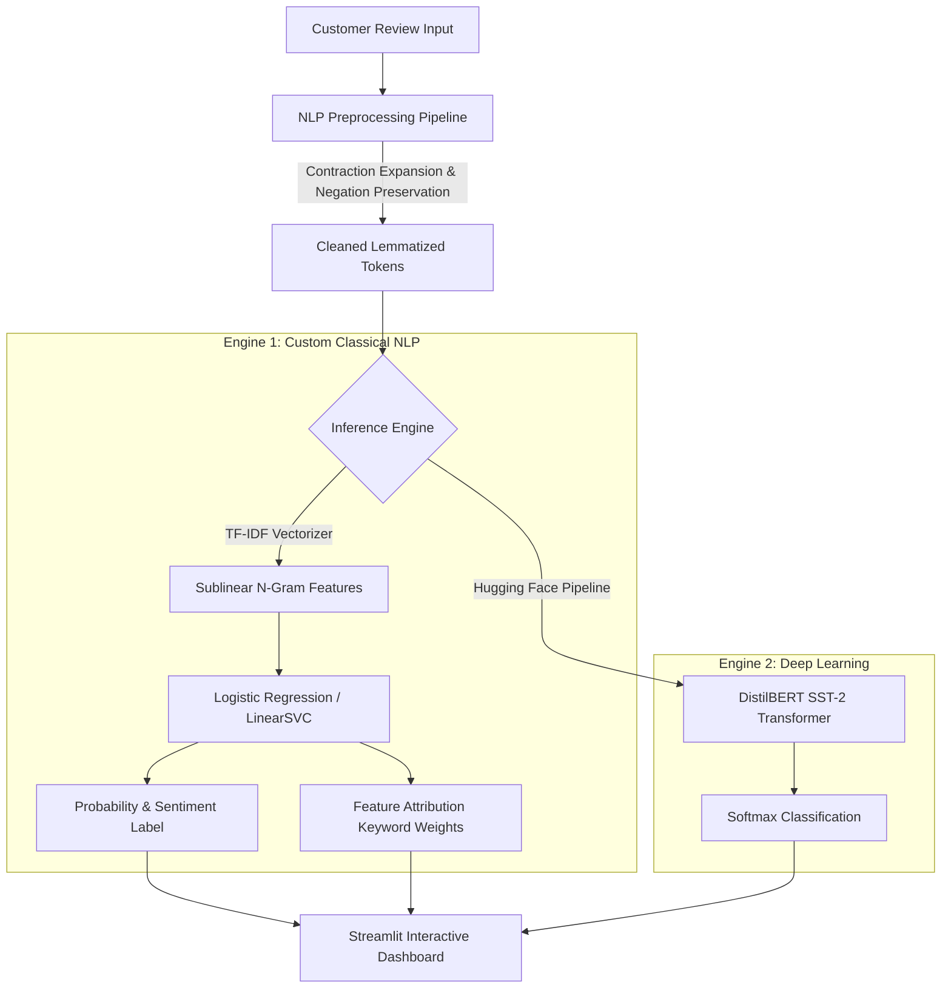

# SentimentScope: End-to-End Customer Review Sentiment Classifier & NLP Engine

[](https://www.python.org/)
[](https://scikit-learn.org/)
[](https://pytorch.org/)
[](https://huggingface.co/)
[](https://streamlit.io/)
[](LICENSE)

A production-ready Natural Language Processing (NLP) system and interactive analytics dashboard designed to ingest, clean, benchmark, and classify customer feedback and reviews. The system features a **custom TF-IDF + Calibrated Classifier pipeline** alongside deep learning **DistilBERT Transformer inference**, complete with **token-level feature attribution (explainability)** and high-speed **batch CSV processing**.

---

## 🌟 Key Features

- **Automated Benchmark Dataset Loader:** Checks local storage (`data/reviews.csv`) or streams and caches the standardized 50,000-record IMDB customer review dataset automatically without manual downloads.
- **Negation-Preserving NLP Preprocessing Pipeline:** Custom text cleaner featuring contraction expansion (e.g., `"don't"` $\rightarrow$ `"do not"`), HTML/URL stripping, punctuation normalization, WordNet lemmatization, and **deliberate preservation of negative polarity words** (`"not"`, `"no"`, `"never"`, etc.) to prevent inverted sentiment classifications.
- **Multi-Model Rigorous Benchmarking:** Side-by-side training and evaluation of 3 classical NLP architectures:
  - **Logistic Regression (L-BFGS)**
  - **Calibrated LinearSVC (Platt-scaled sigmoid probabilities)**
  - **Multinomial Naive Bayes (Laplace smoothing)**
- **Deep Learning Transformer Integration:** Seamless switchable inference using Hugging Face's `distilbert-base-uncased-finetuned-sst-2-english`.
- **Interpretable AI & Token Feature Attribution:** Real-time extraction of top influential positive and negative keywords driving every prediction using model coefficient and TF-IDF weight projections.
- **Interactive Streamlit Web Dashboard (`app.py`):**
  - **Tab 1: Live Sentiment Analyzer:** Instant inference with preset reviews (positive, negative, tricky), confidence progress bars, and keyword attribution chips.
  - **Tab 2: Batch CSV Dataset Analyzer:** Upload any customer feedback CSV, select the text column, run batch inference, visualize sentiment distribution (donut & bar charts), and export labeled CSV files.

---

## 📊 Empirical Model Benchmark Results

Trained on 30,000 stratified, balanced customer reviews with an 80/20 train/test split (6,000 held-out test evaluations):

| Model Architecture | Test Accuracy | Macro Precision | Macro Recall | Macro F1-Score | ROC-AUC Score | Training Time |
| :--- | :---: | :---: | :---: | :---: | :---: | :---: |
| **Logistic Regression (Winner)** 🏆 | **90.33%** | **90.37%** | **90.33%** | **90.33%** | **96.53%** | ~24s |
| **Calibrated LinearSVC** | 90.32% | 90.35% | 90.32% | 90.31% | **96.56%** | ~32s |
| **Multinomial Naive Bayes** | 88.33% | 88.36% | 88.33% | 88.33% | 95.21% | ~50s |

> *Visual evaluation assets (`confusion_matrix.png` and `model_comparison.png`) are automatically generated and saved in `models/` during training.*

---

## 🏗️ System Architecture & Workflow



---

## 📁 Repository Structure

```text
nlp-sentiment-classifier/
│
├── data/                               # Dataset cache directory
│   └── reviews.csv                     # Cached IMDB benchmark dataset
│
├── models/                             # Serialized artifacts & metrics
│   ├── sentiment_tfidf_pipeline.pkl    # Serialized winning Scikit-Learn pipeline
│   ├── metrics.json                    # Benchmark comparison results JSON
│   ├── confusion_matrix.png            # Best model confusion matrix
│   └── model_comparison.png           # Multi-model accuracy/F1/ROC bar chart
│
├── src/                                # Core source code modules
│   ├── preprocess.py                   # NLP text cleaning & negation preservation
│   ├── train.py                        # Automated dataset loader & benchmark trainer
│   └── predict.py                      # Dual-engine inference & explainability
│
├── app.py                              # Modern interactive Streamlit web dashboard
├── requirements.txt                    # Project dependencies
└── README.md                           # Documentation & Portfolio guide
```

---

## 🚀 Quickstart & Setup Guide

### 1. Clone & Navigate to the Repository

```bash
git clone https://github.com/YOUR_USERNAME/nlp-sentiment-classifier.git
cd nlp-sentiment-classifier
```

### 2. Install Dependencies

Ensure your Python environment is active, then install all required libraries:

```bash
pip install -r requirements.txt
```

### 3. Run Training & Benchmarking

Execute the automated training script. This script will automatically download the dataset (if not present), preprocess the corpus, benchmark all 3 models, and export the serialized pipeline:

```bash
python src/train.py
```

### 4. Launch the Interactive Streamlit App

Run the interactive dashboard locally:

```bash
streamlit run app.py
```

Open `http://localhost:8501` in your browser to interact with the application.

---

## 📝 Resume & CV Bullet Points (ATS-Friendly)

Add these high-impact bullet points directly to your CV under your **Projects** section:

- **Customer Review Sentiment Classifier & NLP Pipeline:** Architected an end-to-end NLP classification system benchmarking Logistic Regression, Calibrated LinearSVC, and Naive Bayes on 30,000+ customer reviews, achieving **90.33% Accuracy** and **96.53% ROC-AUC**.
- **Negation-Preserving Text Processing & Explainability:** Engineered a custom preprocessing pipeline featuring contraction expansion, lemmatization, and negation preservation, integrated with token-level feature attribution to extract driving positive/negative keywords for review transparency.
- **Interactive Dual-Engine Production Dashboard:** Developed a Streamlit web application providing real-time single-review analysis and high-throughput batch CSV classification, integrating a fine-tuned Hugging Face **DistilBERT Transformer** alongside the custom sublinear TF-IDF pipeline.

---

## 📄 License

This project is open-source and licensed under the [MIT License](LICENSE).
